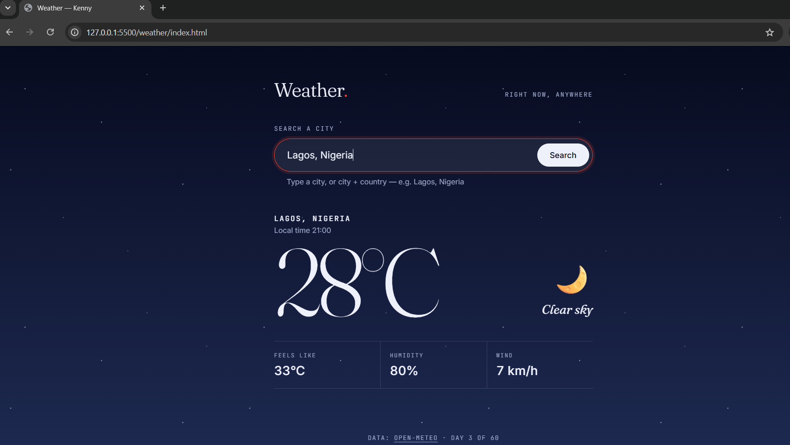
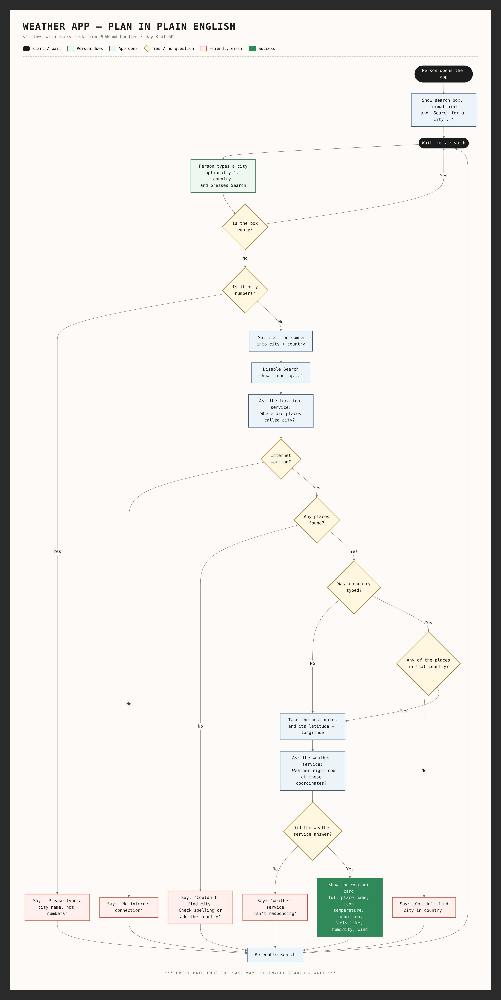

# Weather — Right now, anywhere

Type a city and see its weather right now. The whole page changes to match the sky there: blue for a clear day, stars at night, falling rain, lightning in a storm.

**Live demo:** https://iamkenny-dev.github.io/weather/



## Features

- **Search by city**, or **city + country** (`Lagos, Nigeria`, `London, Ontario`)
- **Understands country nicknames and codes**: `London, UK`, `Kinshasa, DRC`, `Lagos, NG`
- **Current weather:** temperature, condition, feels like, humidity, wind, and the city's local time
- **The page matches the sky:** day, night, cloudy, fog, rain, storm and snow themes, with CSS-only rain, stars, snow and lightning
- **Friendly messages for everything that can go wrong:** city not found, wrong country, numbers typed instead of a name, no internet, service down
- **Can't be double-submitted:** the button locks while a search is loading
- **Accessible:** labelled search box, hint linked to the input, status messages announced to screen readers, and no motion for people who turn animations off
- **No API key:** uses the free [Open-Meteo](https://open-meteo.com/) APIs

## Built with

- HTML
- CSS (custom properties for themes, `clamp()`, `:focus-within`, keyframe animations, gradient-only effects)
- Vanilla JavaScript (`fetch`, `async` / `await`, `try / catch / finally`): no frameworks, no libraries

## How it works

```
"London, UK"
   │  split at the comma → city "London", country "UK" → nickname table → "GB"
   ▼
Location service ── "Where are places called London?" ──▶ up to 10 places
   │  keep only places in GB → take the best match → latitude + longitude
   ▼
Weather service ── "Weather right now at 51.51, -0.13?" ──▶ temperature, weather code, day/night…
   │  weather code 63 → "Rain" 🌧️ → sky theme "rain"
   ▼
Show the card + set <body data-sky="rain"> → CSS restyles the whole page
```

- **Two APIs, because weather services only understand coordinates:** city name → coordinates → weather.
- **One fetch helper** (`getJSON`) turns every failure into a friendly message. It tells the difference between *no internet* (`fetch` throws) and *the server answered with an error* (`response.ok` is false).
- **Lookup tables** translate between what people type and what the data says: country nicknames → ISO codes, and WMO weather codes → words, icons and sky themes.
- **`try / catch / finally`**: every error is shown in one place, and `finally` always unlocks the button.
- Every check in the code is labelled with its risk number from [PLAN.md](PLAN.md).

## Planning

This app was planned before any code was written: goal, MVP, risks, flow, screen sketch, data and milestones. See [PLAN.md](PLAN.md) and the flow diagram:



## Run it locally

1. Clone the repo:
   ```bash
   git clone https://github.com/iamkenny-dev/weather.git
   ```
2. Open `index.html` in your browser, or use the **Live Server** extension in VS Code.

No install, build step or API key is needed.

## What I learned

- Calling APIs with `fetch`, and reading JSON responses
- `async` / `await`, and why requests take time
- Handling errors properly: `response.ok`, `throw`, `try / catch / finally`
- Reading input with `split`, `trim` and a regular expression (`/\p{L}/u`)
- Lookup tables to translate data
- Theming a whole page with CSS custom properties and a `data-` attribute
- Planning an app before coding: MVP, risks and milestones

## Roadmap (v2)

- [ ] "Use my location" button
- [ ] Remember the last city searched
- [ ] 7-day forecast
- [ ] °C / °F switch

---

Day 4 of my 60-app challenge. See more on my [portfolio](https://iamkenny-dev.github.io/portfolio/).